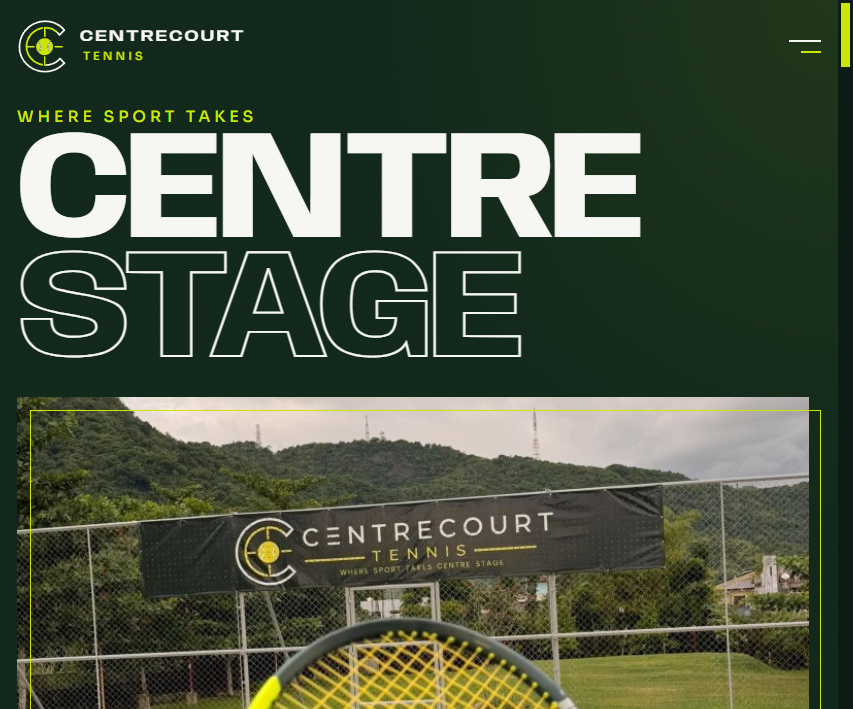
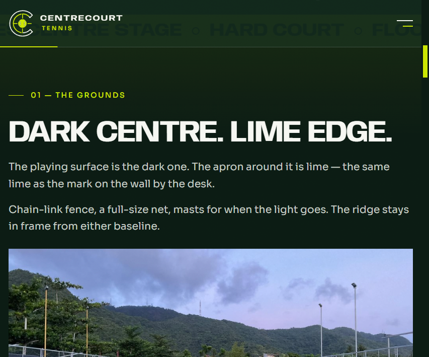
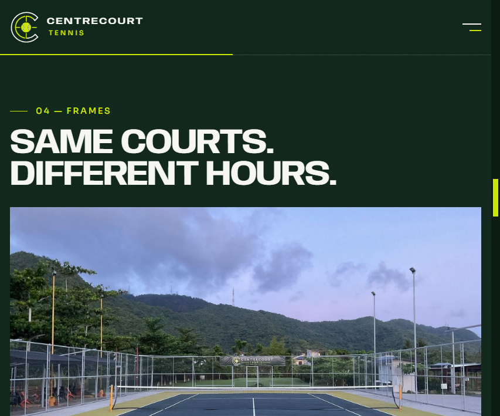
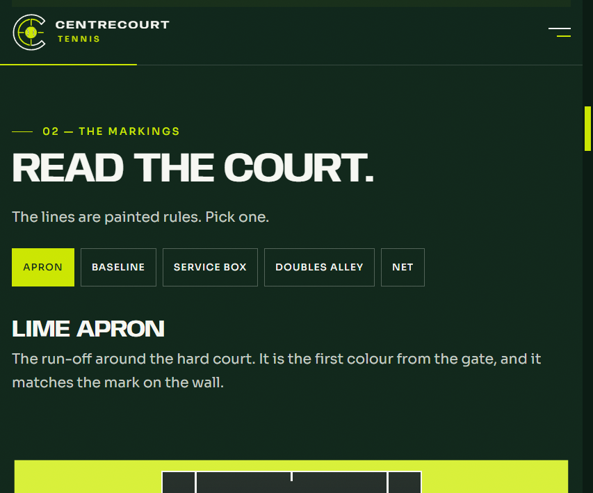
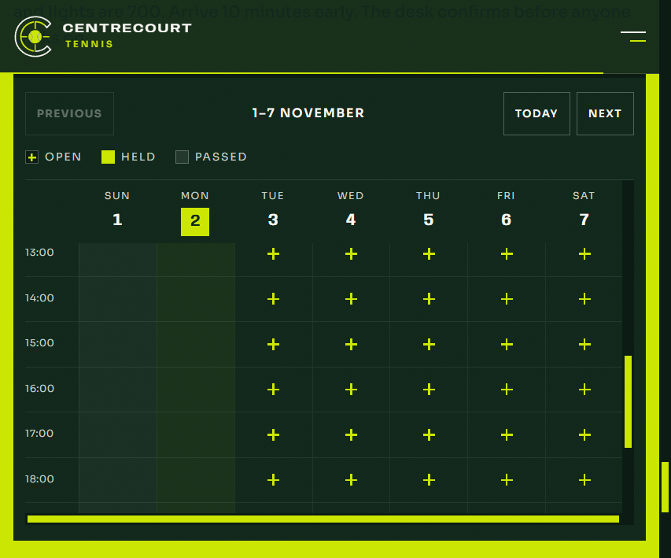

<p align="center">
  
</p>

<p align="center">
  Outdoor hard courts. A dark playing surface, a lime apron, floodlights for when the ridge takes the sun.<br />
  The desk holds the hour. Nobody walks on until the desk confirms.
</p>

<p align="center">
  
  
  
</p>

<p align="center">
  
  
</p>

## The court

Chain-link, a full-size net, masts over the fence, and the ridge in frame from either baseline. The mark on the wall by the desk is the same lime as the apron.

The page is that place. Forest ground, lime lines, the C on its own in the bar and the footer. The entrance plays on every refresh.

## The hour

The schedule is a week of one-hour blocks, the same way the court is actually booked.

| | |
| --- | --- |
| Daytime, 06:00–16:00 | 600 pesos an hour |
| Evening and lights | 700 pesos an hour |

An open hour takes a name, a mobile number, and whether a coach is needed. Arrive 10 minutes early. The desk stores each hold, and the board shows that hour as held.

## Run it

```bash
npm install
npm install --prefix frontend
npm install --prefix backend
npm run dev
```

The site is [http://localhost:5173](http://localhost:5173). The desk API is [http://localhost:8787](http://localhost:8787).

`npm run dev:web` and `npm run dev:api` start them on their own.

## In the tree

`frontend` is Vite, React, and TypeScript. `backend` is a small Hono server for the gate, the board, and the desk. Players, sessions, and held hours are in the Supabase book. `backend/data` is an old file copy and is not in this repo.
